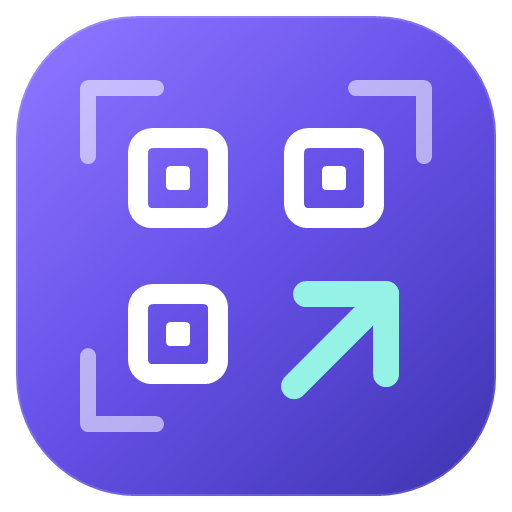
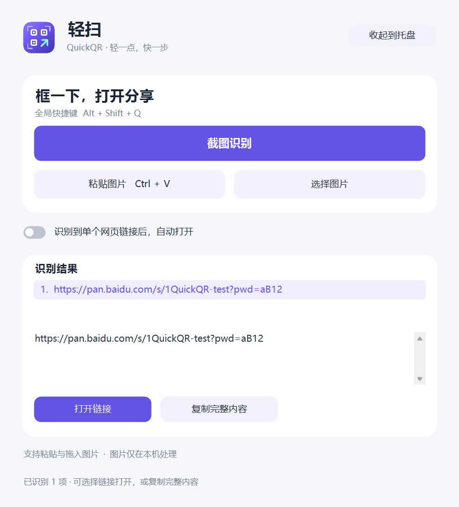

<p align="center"></p>
<h1 align="center">轻扫 QuickQR</h1>
<p align="center">框一下，打开分享。轻量、离线识别的 Windows 二维码工具。</p>
<p align="center">Windows 10 / 11 · x64 · C++ / Win32 · 约 1 MB</p>
<p align="center"></p>

## 功能

- **截图识别**：按 `Alt + Shift + Q`，框选完整二维码后松开鼠标。
- **粘贴与拖放**：在窗口中按 `Ctrl + V` 粘贴图片，或拖入图片文件。
- **自动打开**：单个 HTTP/HTTPS 链接交给默认浏览器；多个结果供选择。
- **网盘分享**：支持百度网盘、夸克、阿里云盘等二维码中的网页链接，保留链接参数和文字提取码。
- **托盘模式**：手动收起到托盘，快捷键继续生效；关闭窗口直接退出。
- **本地处理**：不上传图片、不保存截图或识别历史。程序本身不发起网络请求。

## 使用

下载 Releases 中的 Windows x64 便携包，解压后运行 `QuickQR.exe`。无需安装运行时或管理员权限。

打开含二维码的网页，按 `Alt + Shift + Q`，框选二维码（保留四周白边）即可。Esc 或右键取消截图。默认自动打开单个网页链接，也可以关闭自动打开后手动查看结果。

“复制完整内容”保留链接和文字提取码。独立的文字提取码不会自动填写到网页中。支持 PNG、JPG、BMP、GIF、TIFF，动画及多帧图片只读取首帧，一次处理一张图片。

自动打开设置保存在 `%LOCALAPPDATA%\QuickQR\settings.ini`。不设开机自启。退出后删除程序目录及自行创建的快捷方式即可卸载。

## 轻量设计

原生 Win32 / GDI+ 界面，静态链接 ZXing-C++。无需 Qt、Electron、WebView、Python 或 .NET 运行时，仅依赖 Windows 系统 DLL。

开发机测得启动后工作集约 **31 MB**、私有提交内存约 **10 MB**。实际内存随字体缓存、显示分辨率和截图变化；截图期间临时增长，识别后释放像素缓冲。这不是所有机器的保证值。

## 从源码构建

需要 Visual Studio 2022 C++ Build Tools、Windows SDK 和 CMake 3.24+。在项目根目录执行：

```powershell
cmake -S . -B build -G "Visual Studio 17 2022" -A x64
cmake --build build --config Release --parallel
ctest --test-dir build -C Release --output-on-failure
```

输出为 `build/Release/QuickQR.exe`。随附固定版本 ZXing-C++ 源码，构建无需额外下载依赖。GitHub Actions 会构建、执行核心回归检查并生成便携包。

详细说明见 [DEVELOPMENT.md](DEVELOPMENT.md)。图标提供 [SVG](assets/app.svg)、PNG 和 16–256 像素九种尺寸的 ICO；运行 `scripts/generate-icon.ps1` 可重新生成配套 Windows 图标。

## 已知限制

- 模糊、过小、损坏或遮挡严重的二维码可能无法识别。
- 不验证网盘分享有效性，不绕过登录或提取码。
- 仅打开 HTTP/HTTPS；普通文本和其他协议只显示供复制。
- 图片最多 8000 万像素，单边不超过 24000 像素；识别时长边最多缩小到 4096 像素。
- 混合 DPI 多显示器尚未完整实机验证；快捷键冲突时请用窗口按钮。
- EXE 尚未代码签名。

## 第三方组件

ZXing-C++ v3.1.1（Apache-2.0），含 libzueci（BSD-3-Clause）等组件。见 [licenses](licenses) 中的版权声明。第三方源码保持上游原样。图标和应用代码由本项目编写。
